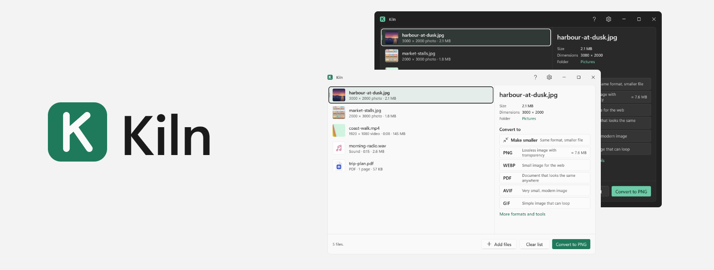
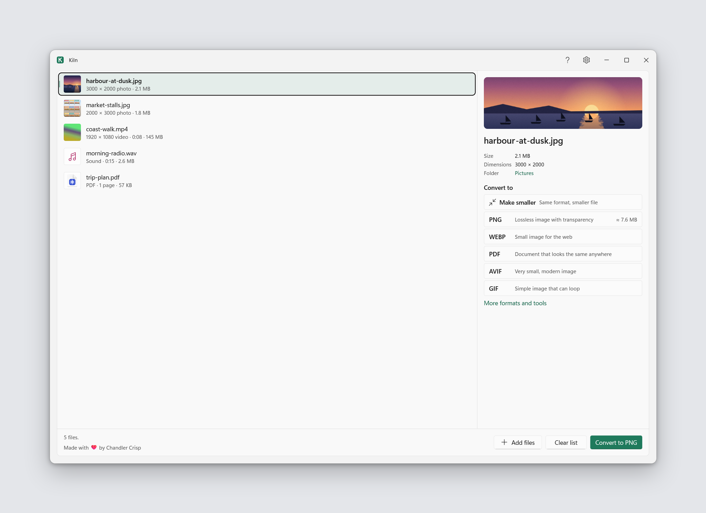
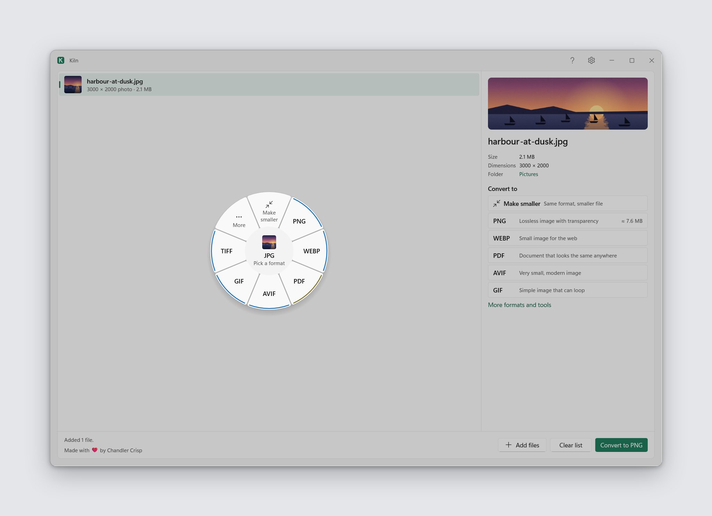
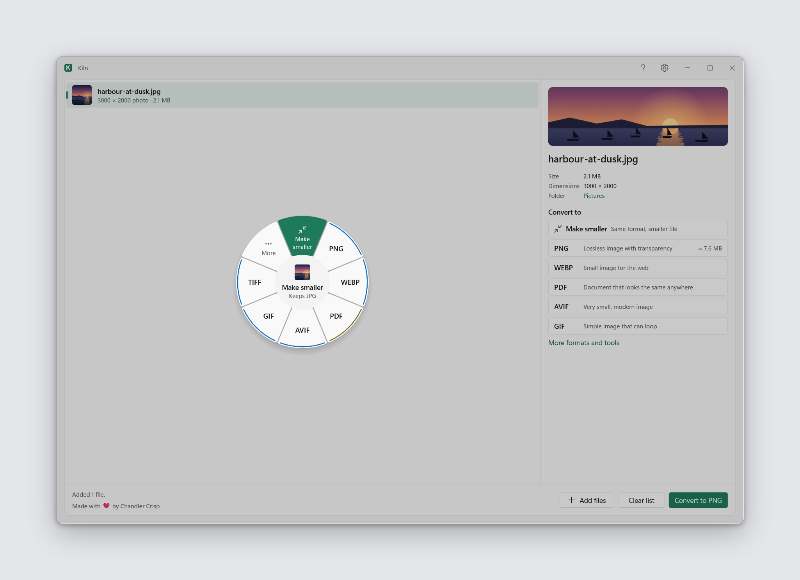
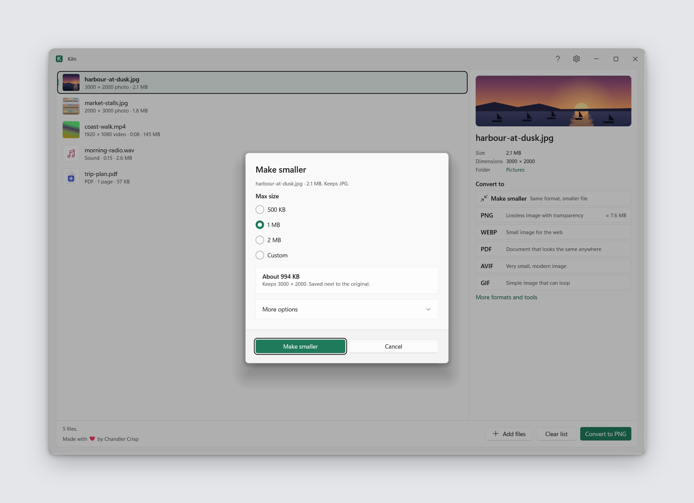
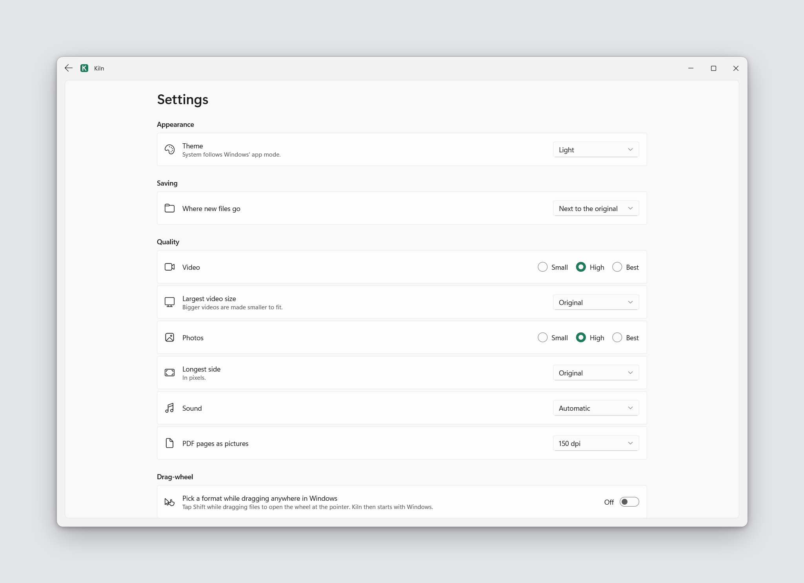
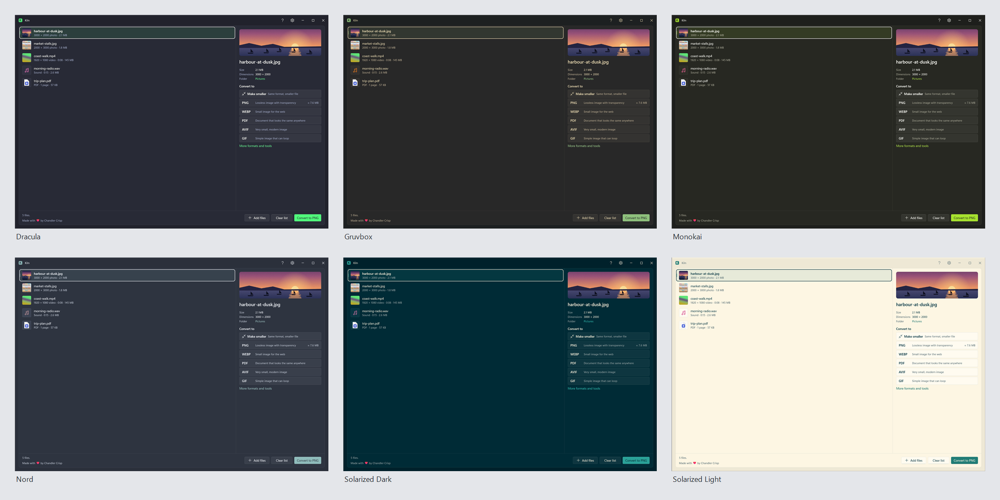

<div align="center">

<picture><source media="(prefers-color-scheme: dark)" srcset="docs/readme/banner-dark.png"></picture>

A file converter for Windows 10 and 11.

<a href="https://github.com/chancrisp/kiln/releases"></a>
<a href="LICENSE"></a>
<a href="https://www.rust-lang.org"></a>

</div>

## What is Kiln?

Kiln turns one kind of file into another, and makes files smaller. Drop files
on its window and a wheel of the formats they can become opens where they
landed. Pick one, and the new file is saved next to the original, with
**Show in folder** on its row.

- **Ways in.** Drop files on the window, choose **Add files** (<kbd>Ctrl</kbd>+<kbd>O</kbd>), paste files copied in File Explorer (<kbd>Ctrl</kbd>+<kbd>V</kbd>), or right-click files in File Explorer and choose **Open with**, then Kiln. A folder adds the files in it.
- **The wheel.** Files of one kind open a ring of the formats they can become, with **Make smaller** first where it works and **More** for every other format and the tools. Picking a format converts at once with the quality set in Settings; <kbd>Tab</kbd> on a format, or the last row of More (`Options for JPG…`), opens its options first.
- **Make smaller.** MP4, MOV, M4V and MKV video, JPG, PNG and WEBP photos, and PDF, in the same format, at or under a size you pick, with an estimate before it starts. Kiln never saves a copy over that size or larger than the original.
- **Photo tools.** **Resize** brings a photo's long side down to a size, and **Remove location data** saves a copy without where it was taken and the camera details.
- **Progress you can read.** A converting row has a progress bar, its percentage and **Cancel**. A finished one says what it saved and how much smaller it is, with **Show in folder**. A failed one says what happened in one line, with **Show details**, and **Retry** where trying again can help.
- **The side pane.** In a wide window, a pane beside the list shows the selected file: its picture, what it is, the formats it can become with what each is for and an estimate, and what happened to it.
- **The drag-wheel**, if you turn it on: pick a format while dragging a file anywhere in Windows. [The drag-wheel](#the-drag-wheel) says how.
- **A command line too.** `kiln convert photo.png jpg` does the same work from a terminal.
- **Light, dark and six more themes**, Windows' contrast themes, every monitor's scale, Windows' Text size and Animation effects, the keyboard and Narrator.

<div align="center">

<picture><source media="(prefers-color-scheme: dark)" srcset="docs/readme/main-window-dark.png"></picture>

</div>

## What needs nothing else installed

The MSI and the portable ZIP on the release page come with FFmpeg, an LGPL
build in the `ffmpeg` folder beside Kiln. On a PC with nothing else
installed, Kiln converts:

- photos and pictures: PNG, JPG, WEBP, BMP, GIF, TIFF, ICO, TGA, QOI, PPM, SVG, HEIC, AVIF and JPEG XL, and camera RAW (on older Windows builds, RAW needs Microsoft's Raw Image Extension);
- sound: WAV, MP3, FLAC, OGG, OPUS, M4A, AAC, AIFF, WMA, AC3 and WV;
- video: MP4, MOV, M4V, MKV, WEBM, AVI, WMV, FLV, MPG, TS, 3GP and OGV, animated GIF, WEBP and APNG, and subtitles;
- PDF to text, and PDF pages to pictures;

and Make smaller, Resize, Remove location data and the other tools work.

Documents, office files and e-books need a free helper app (see
[Install](#install)): Pandoc for documents, LibreOffice for office files,
spreadsheets, slides and documents to PDF, and Calibre for MOBI and AZW3. A
file that needs one says which, with **Get it** to open the app's download page.

## First run

The empty window has **Add files** and, until you dismiss it, a short
**How it works** card:

1. Drop files here, or choose **Add files**.
2. Pick a format. To keep the format and shrink the file, pick **Make smaller**.
3. The new file is saved next to the original. **Show in folder** takes you to it.

Help (<kbd>F1</kbd>) has **Show first-run help** to bring the card back.

## The wheel

A plain drop of files of one kind opens the format wheel where they landed.
Files of several kinds that share no format are listed, and an InfoBar says
why: pick one file or one kind at a time. <kbd>Esc</kbd> closes the wheel and
the files stay listed.

- **Formats.** One ring of the formats the files can become, most wanted first: for photos JPG, PNG, WEBP, PDF, AVIF, GIF and TIFF; for video MP4, MP3, GIF, MOV, WEBM, MKV and M4A; for sound MP3, M4A, WAV, FLAC, OGG and AAC; for documents PDF, DOCX, TXT, HTML, ODT, RTF and EPUB; for a PDF DOCX, PNG, JPG and TXT. The file's own format is left out.
- **More** opens a list beside the ring: every other format under its kind's heading, then the tools, then a last row such as `Options for JPG…`, for the format last lit, or else the suggested one.
- **The hub** shows the file's picture, what the pick makes (`JPG → PNG`) and its estimate.
- **Keys.** With files selected, <kbd>Enter</kbd> converts to the format the side pane outlines, or opens the list of formats when the pane is folded or has none, and <kbd>Ctrl</kbd>+<kbd>Enter</kbd> opens the tools. In the wheel the arrows move round it, <kbd>Enter</kbd> picks and <kbd>Esc</kbd> closes.
- **Several files** of one kind are offered every format any of them can become. A file already in the format picked is left alone and its row says `Already JPG`.
- **Other ways to pick.** The side pane's **Convert to** list, the list the footer's **Convert** opens and a row's **Convert to…** in its right-click menu offer the same formats. With the side pane showing, **Convert** converts to the format the pane outlines.

<table>
  <tr>
    <td align="center" valign="top"><picture><source media="(prefers-color-scheme: dark)" srcset="docs/readme/format-choice-dark.png"></picture><br><b>THE WHEEL</b><br><sub>Opens where the files land. The hub shows the file and what a pick makes.</sub></td>
    <td align="center" valign="top"><picture><source media="(prefers-color-scheme: dark)" srcset="docs/readme/format-choice-lit-dark.png"></picture><br><b>A PICK LIT</b><br><sub>The slice under the pointer or the arrows fills, and the hub says what it makes.</sub></td>
  </tr>
</table>

## Make smaller

**Make smaller** is on the wheel, in the side pane and in the right-click menu
for MP4, MOV, M4V, MKV, JPG, PNG, WEBP and PDF. It opens a dialog:

- **Max size** as a few sizes for the kind of file (video 10, 25 and 50 MB; photos 500 KB, 1 and 2 MB; PDF 1, 5 and 10 MB) or **Custom**. A size the file is already under says `already smaller`.
- **An estimate** of the result, and what becomes of the picture.
- **More options:** for video, the largest picture size and whether to keep the sound; for photos, a long side to resize to and **Remove location data**.

The copy keeps the format and is named `name (smaller).ext`. A size Kiln can't
reach saves nothing and says so, as in
`Can't get this under 1 MB. The smallest Kiln can make is about 2.3 MB.`

- **Video** is encoded again on the graphics card, or the processor where there is none, with its sound copied where it fits.
- **Photos** keep their colour profile and their details, unless **Remove location data** is on. A PNG gets fewer pixels, never fewer colours.
- **PDF** is tidied, then its photos are saved as JPG at lower qualities and sizes until it fits. Its text, drawing and fonts are kept as they are, so a PDF of text and drawing shrinks little.

<div align="center">

<picture><source media="(prefers-color-scheme: dark)" srcset="docs/readme/make-smaller-dark.png"></picture>

</div>

## Where new files go

Each result is saved as soon as it is ready, under a free name: Kiln never
replaces a file. A taken name becomes `name (1).jpg`. **Settings > Saving >
Where new files go** is **Next to the original** or **A folder I choose…**.

When Kiln can't save there, as on a camera card or when the chosen folder is
gone, the result goes to `Documents\Kiln results` and the row says so, as in
`Saved in Documents\Kiln results. Kiln can't save in DCIM.` When even that
fails, Kiln keeps the result and tries again the next time it starts.

## The drag-wheel

The drag-wheel is off until you turn it on in **Settings > Drag-wheel**
(**Pick a format while dragging anywhere in Windows**). While it is on:

- Drag files from File Explorer, the desktop or another app and tap <kbd>Shift</kbd>: the same wheel opens under the pointer. Drop on a format and Kiln converts the files with Settings' quality and saves each result where new files go, without bringing its window forward. Drop on **Make smaller** or **Resize** and Kiln comes forward with its dialog. Tap <kbd>Shift</kbd> again for the tools.
- Kiln starts with Windows, in the notification area with no window, so the drag-wheel works from the start of the session. Task Manager lists it under Startup apps. Turning the drag-wheel off removes that entry.
- Closing the window leaves Kiln in the notification area. Its icon's menu has **Open Kiln**, **Drag-wheel** and **Quit Kiln**.
- One notification a drop says what was saved, with **Show in folder**.

A `settings.toml` from an earlier Kiln that had the drag-wheel on turns it off
once, and Kiln says so at the top of its window.

## Options and quality

Picking a format converts at once with the quality in **Settings > Quality**.
To change it for one conversion, press <kbd>Tab</kbd> on the format in the
wheel, or choose the options row at the end of More's list or **Options** on a finished drag-wheel row. The
options dialog shows the format and the file, what the conversion leaves out,
**Quality** (**Small**, **High** and **Best**, and for a video whose picture
can be copied **Original (no re-encode)**), the size it would come to, and
**More options** with the settings that fit the file: a **Quality** drop-down
with every step between the marks, the largest picture size, the sound,
**Max size** and the like. A pair with nothing
to set opens no dialog.

**Small** makes noticeably smaller files, fine for sharing. **High**, the
default, looks like the source for most material. **Best** stays as close to
the source as the format allows. Sizes are caps: Kiln never scales up.

**Settings > Quality** holds the defaults: Video and Photos as Small, High and
Best, Largest video size, Longest side, Sound and PDF pages as pictures.
From the command line: `--preset`, `--size`, `--fps`, `--audio-kbps`, `--dpi`
and `--quality` (JPG and WEBP, 1 to 100).

Between MP4, M4V, MOV and MKV, when the video and sound fit the new container
and nothing changes them, Kiln copies them without encoding again. Otherwise
it writes H.264, or HEVC if you choose, on the graphics card where there is
one. Phone video comes out upright; HDR video written as HEVC on the graphics
card stays HDR.

## Formats

Kiln knows 85 formats and converts between 1,245 pairs. When no single helper
app does a pair, Kiln chains two steps through a shared format, such as HEIC to
JPG through PNG, or MOBI to PDF through DOCX. The steps run in one temporary
folder, and only the finished file is kept, where new files go (see
[Where new files go](#where-new-files-go)).

| Kind | Reads | Converts to | Helper app |
|---|---|---|---|
| Image | PNG, JPG, WEBP, BMP, GIF, TIFF, ICO, TGA, QOI, PPM | any other of those, plus AVIF, JXL and PDF | built in |
| | SVG, and camera RAW: DNG, CR2, CR3, NEF, ARW, ORF, RW2, RAF, PEF, SRW | the image formats above, and PDF | built in (resvg draws SVG, Windows decodes RAW) |
| | HEIC, AVIF | any image format above, and PDF | Windows, through Microsoft's HEIF Image, HEVC Video and AV1 Video Extensions, or FFmpeg (comes with Kiln) |
| | JXL | any image format above, and PDF | FFmpeg (comes with Kiln) |
| Animation | GIF, APNG | any video format | FFmpeg (comes with Kiln) |
| Audio | WAV, MP3, FLAC, OGG, OPUS, M4A, AAC, AIFF, WMA, AC3, WV | any other audio format | built in (AAC, M4A, WMA and AC3 use Windows' codecs, and MP3 uses LAME) |
| Video | MP4, M4V, MOV, MKV | each other | built in (Windows' codecs) |
| | MP4, M4V, MOV, MKV, WEBM, AVI, WMV, FLV, MPG, TS, 3GP, OGV | any other video format, or an animated GIF, WEBP or APNG | FFmpeg (comes with Kiln) |
| | MP4, M4V, MOV, MKV, WEBM | their sound, as any audio format | built in, as audio |
| | AVI, WMV, FLV, MPG, TS, 3GP, OGV | their sound, as any audio format | FFmpeg (comes with Kiln) |
| Subtitles | SRT, VTT, ASS | any other of those. MKV and MP4 give up their first subtitle track | FFmpeg (comes with Kiln) |
| Document | MD, HTML, DOCX, ODT, EPUB, RST, TEX, ORG, ADOC, TYP, WIKI, TEXTILE, DBK, FB2, IPYNB | any other of those, plus RTF, TXT and PPTX | Pandoc |
| | the same | PDF and DOC | Pandoc, then LibreOffice |
| E-book | EPUB, MOBI, AZW3 | any other of those. MOBI and AZW3 also become documents and PDF | Calibre |
| PDF | PDF | TXT, and PNG, JPG, WEBP, BMP or TIFF with one image per page | built in (Windows draws the pages) |
| | | DOCX, ODT, DOC, RTF, the Pandoc formats, MOBI and AZW3, from its text | built in, then the document helper apps |
| Office document | DOC, RTF, TXT, and read only PAGES and WPD | DOC, DOCX, ODT, RTF, PDF, and through DOCX the Pandoc formats | LibreOffice |
| | DOCX, ODT | DOC, PDF, and PNG or JPG with one image per page | LibreOffice |
| | read only VSDX and PUB | PDF, and PNG or JPG with one image per page | LibreOffice |
| Spreadsheet | XLSX, XLS, ODS, CSV, and read only NUMBERS | XLSX, XLS, ODS, CSV, PDF and HTML | LibreOffice |
| Presentation | PPTX, PPT, ODP, and read only KEY | PPTX, PPT, ODP, PDF, and PNG or JPG with one image per slide | LibreOffice |

Kiln reads WAV (RF64 files past 4 GB too), AIFF, FLAC, MP3, OGG, OPUS (in WEBM
too), M4A and AAC (ALAC too), WMA, AC3 and WV, and writes every audio format in
the table. MP3 is written by LAME. AAC, M4A, WMA and AC3 are written by the
codecs in Windows, except AC3 with 5.1 channels, which Kiln's own encoder
writes. A video with no sound says so on its row.

Between MP4, M4V, MOV and MKV, Kiln reads and writes the containers itself and
uses Windows to decode and encode. FFmpeg still does the other video formats,
GIFs and the video tools, and, as a fallback, a pair among the four when
Windows can't read the video (ProRes, for example), when the extension that
reads it isn't installed, when the file's sound is one Kiln can't read, and on
a PC without Media Foundation.

Aliases are accepted on input: JPEG, JFIF, TIF, PNM, PGM, PBM, PAM, NRW, SRF,
SR2, HEIF, HIF, OGA, AIF, MPEG, VOB, MTS, M2TS, SSA, MARKDOWN, HTM, TEXT,
ASCIIDOC, MEDIAWIKI, DOCBOOK, AZW and VSD. The full list lives in
[`crates/kiln-core/formats.toml`](crates/kiln-core/formats.toml), and
`kiln formats FILE` prints what a given file can become.

| Tool | Works on | What it does |
|---|---|---|
| Make smaller | MP4, MOV, M4V and MKV video, JPG, PNG and WEBP images, PDF | Saves a copy in the same format at or under a size (`--max-size`), and saves nothing if it can't get there or the copy wouldn't be smaller. A video is encoded again on the graphics card (or the processor when there is none), with its sound copied where it fits. A photo keeps its colour profile and its details unless Remove location data is on, and a PNG gets fewer pixels, never fewer colours. A PDF is tidied, then its photos are saved as JPG at lower qualities and sizes until it fits; its text, drawing and fonts are kept as they are |
| Resize | JPG, PNG, WEBP, GIF, TIFF, BMP, HEIC and AVIF images | Saves a copy with the long side brought down to a size (`--long-side`), named `name (1920 px).ext`. Never enlarges. HEIC and AVIF become JPG |
| Remove location data | JPG, PNG, WEBP, GIF, TIFF, BMP, HEIC and AVIF images | Saves a copy without where it was taken and the camera details, keeping the picture, its colour profile and its orientation. HEIC and AVIF become JPG |
| Remove borders, Remove black bars | images, video | Removes plain borders from images and black bars from video |
| Remove silence at the ends, Remove black at the ends | audio, video | Cuts silence from the start and end of audio, and stretches that are both black and silent from video |
| Cut in half | audio, video | Cuts audio and video into two halves |
| Save each page as a PDF | PDF | Writes one PDF per page |
| Merge | two or more audio, video, document or PDF files of one type, or images | Joins them in order. Images become one PDF, a page each |

## What a conversion keeps and leaves out

Where a conversion drops something, the options dialog says so under the file's
line before **Convert**, the row says so while it converts and once it is done,
and the drag-wheel's notification adds it after its sentence. With several
files, a note is shown only when it holds for every one.

- **Sound tracks.** A video with several sound tracks keeps the first one when it becomes another video or a sound file: `Keeps the first of 2 sound tracks.` FFmpeg takes the first picture and the first sound track. Where Kiln's own engine reads the file, it takes the first track it can read, which is a later one when the first is AC-3, E-AC-3, DTS or TrueHD. Kiln leaves the note out there.
- **Subtitles.** A video becoming another video doesn't keep its subtitle tracks: `Subtitles aren't kept.`
- **Text only.** A PDF becomes a document, an e-book or slides from its text alone: `Keeps the text only: no pictures, tables or layout.` The target then reads `DOCX (text only)` in the options dialog and to Narrator, when every selected file is such a PDF.
- **Spreadsheets.** A workbook with several sheets converts to CSV as one file for each sheet, named after the workbook and the sheet, such as `book-Sales.csv` and `book-Notes.csv`. A workbook with one sheet makes `book.csv`.
- **Pictures in a document.** When Pandoc turns a document into DOCX, ODT, EPUB, PPTX, RTF, FB2 or IPYNB (a Markdown or HTML file, say), the pictures in the document's own folder and the folders inside it go in. A picture from a web address, or from outside that folder, becomes its alt text. Targets that only name their pictures, such as Markdown and HTML, keep the picture references as written.
- **Photos.** A photo's EXIF orientation is applied, so it comes out upright, and its colour profile goes into the JPG, PNG, TIFF or WEBP when it is 4 MB or smaller. A larger profile is left out, and the conversion goes on.
- **WEBP.** It is written lossy at the quality of the preset, or of `--quality`, with transparency kept. An animated GIF converted to WEBP stays animated: every frame, its timing and its loop count. A GIF with no loop count plays once.
- **Gaps in sound.** When sound is re-encoded and a gap of 100 ms or more is left in its timestamps, as when a stretch is cut from an MKV, Kiln puts silence there so the sound stays in step with the picture. FLAC is included, since its timestamps come from its frame headers. A gap gets at most 10 minutes of silence, and so does one file in all. A packet the decoder refuses is skipped, not filled.

## Install

- **Installer.** `Kiln-<version>-x64.msi` installs into Program Files, adds a Start menu entry and puts `kiln` on PATH. It also adds Kiln to Open with for the files it converts, and, for the account that installs it, to Send to.
- **Portable.** Unzip `Kiln-<version>-x64-portable.zip` anywhere and run `kiln-app.exe`.

Both have FFmpeg in the `ffmpeg` folder beside `kiln-app.exe`: an LGPL build,
without x264 or x265, so H.264 and HEVC from it are Windows' own encoders.
Its licence, the licences of the libraries built into it, how it was built and
where to get its source are in that folder, and in **Settings > About >
Licences and third-party notices**. **Settings > Helper apps > Use another
copy…** points Kiln at a different FFmpeg; a full build chosen there writes
H.264 and HEVC with x264 and x265.

| Helper app | Needed for |
|---|---|
| FFmpeg (comes with Kiln) | video other than MP4, MOV, M4V and MKV, GIFs, subtitles, JPEG XL, writing AVIF, the video and audio tools other than Make smaller, and pictures Windows can't read. Also the fallback for MP4, M4V, MOV and MKV video Windows can't read (ProRes, for example) and on a PC without Media Foundation |
| [Pandoc](https://pandoc.org/installing.html) | documents |
| [LibreOffice](https://www.libreoffice.org/download/) | office files, spreadsheets and slides, and documents to PDF |
| [Calibre](https://calibre-ebook.com/download) | MOBI and AZW3 e-books |

Kiln looks for helper apps on PATH and in their usual install folders, and
finds one installed while it runs, without a restart. **Settings > Helper
apps** shows what it found, with **Get it** and **Choose…** for one it didn't,
and **Install with winget** for Pandoc, LibreOffice or Calibre where Windows
has winget.
Each LibreOffice job runs with a fresh profile in its own temporary folder,
with macros and self-updating links turned off, and an RTF's linked pictures
are cut out of a copy before LibreOffice opens it.

Windows' codecs write AAC, M4A, WMA and AC3, and read HEIC, AVIF, HEVC, AV1
and VP9 through Microsoft's extensions:

- **HEIC and AVIF** are read by Windows through the HEIF Image and HEVC Video Extensions and the AV1 Video Extension, and by the included FFmpeg where Windows can't. A transparent AVIF goes to FFmpeg, so its transparency is kept.
- **HEVC, AV1 and VP9 video** that Kiln's own engine reads need the extension for that codec when the picture is encoded again; a copy needs none. The included FFmpeg converts the file instead where the extension is missing. **Get it** opens the extension's page in the Microsoft Store.
- **N editions** of Windows leave the codecs out until the Media Feature Pack is added. A file that needs them says `Needs Windows' Media Feature Pack, which isn't installed.`, and **Install it** opens Settings > Optional features.
- **MP3** is written by `lame_enc.dll`, beside `kiln-app.exe` and `kiln.exe`. If it is missing, the row says `Kiln's MP3 encoder is missing. Reinstall Kiln to fix it.`

**Check for updates** in **Settings > About** asks GitHub for the latest
release when you press it. [PRIVACY.md](PRIVACY.md) says what that request
carries and what Kiln keeps on your PC.

Releases are signed as the [code signing policy](docs/code-signing-policy.md)
describes. Until a release is signed, Windows SmartScreen may warn before Kiln
starts: choose **More info**, then **Run anyway**.

**Uninstalling** removes Kiln's programs, its Start menu entry, its start-up
entry and its Open with and Send to entries. It keeps your settings in
`%APPDATA%\Kiln` and the log, crash reports and any results waiting to be
saved in `%LOCALAPPDATA%\Kiln`, so a later install starts where you left off.
Delete those folders after uninstalling to remove them.

## Settings

Open Settings with the gear in the title bar or <kbd>Ctrl</kbd>+<kbd>,</kbd>.
It is one page: **Appearance** (theme), **Saving** (where new files go), **Quality** (the defaults), **Drag-wheel**,
**Helper apps** and **About**. **Back** or <kbd>Esc</kbd> closes it.
**Theme** offers System, Light and Dark, and Dracula, Gruvbox, Monokai, Nord,
Solarized Dark and Solarized Light. A Windows contrast theme, when one is on,
takes over from all of them. Every
change is saved straight away to `%APPDATA%\Kiln\settings.toml`, which you can
also edit by hand:

```toml
save_to = 'D:\Converted'         # where new files go; leave out for next to
                                 # the original
theme = "system"                 # system, light, dark, dracula, gruvbox, monokai,
                                 # nord, solarized-dark or solarized-light
drag_wheel = false               # true turns the drag-wheel on

[quality]                        # the defaults in Settings > Quality
video = "high"                   # small, high or best
resolution = "original"          # original, or a cap in lines: 1080
images = "high"                  # small, high or best
image_size = "original"          # original, or a cap on the long side: 2048
audio_kbps = 192                 # leave out to follow the preset
page_dpi = 150                   # 36 to 600

[engines]                        # leave out for the FFmpeg that comes with
                                 # Kiln, then PATH
ffmpeg = 'C:\Tools\ffmpeg\bin\ffmpeg.exe'
pandoc = 'C:\Program Files\Pandoc\pandoc.exe'
libreoffice = 'D:\LibreOffice\program\soffice.exe'
calibre = 'C:\Program Files\Calibre2\ebook-convert.exe'
```

An older `settings.toml` with a `save_next_to_original` line still loads; the
line goes the next time settings are saved. A file Kiln can't read is left
alone: the app starts with the defaults and says why.

<table>
  <tr>
    <td align="center" valign="top"><picture><source media="(prefers-color-scheme: dark)" srcset="docs/readme/settings-dark.png"></picture><br><b>SETTINGS</b><br><sub>One page of cards. Every change is saved straight away.</sub></td>
    <td align="center" valign="top"><br><b>THEMES</b><br><sub>Dracula, Gruvbox, Monokai, Nord, Solarized Dark and Solarized Light, beside Light and Dark.</sub></td>
  </tr>
</table>

## Logs and recovery

- **Logs.** Kiln writes `kiln.log` in `%LOCALAPPDATA%\Kiln\logs`, a line for each failed conversion and for other things worth knowing later. At 1 MB it becomes `kiln.1.log`, replacing the one before, so the logs take 2 MB at most.
- **Crash files.** A crash writes `crash-<date>-<time>-<process>.txt` beside the log, with the problem, where it happened, a backtrace, Kiln's version and commit, and the Windows version. The newest 10 are kept.
- **After a crash in the window.** Kiln shows `Kiln ran into a problem and has to close. Your converted files are kept, and Kiln saves them the next time it starts. A report was saved in` the logs folder, and closes. A crash in a conversion fails only that conversion, and leaves a crash file too.
- **Results on their way.** Kiln makes each result on the drive of the file it came from, and keeps it there until it is saved, in a hidden `<drive>\.kiln-held\<your account's id>\<run>` folder that only your account, SYSTEM and administrators can open (on NTFS), so saving next to the original on that drive is a rename. Since results wait on the file's own drive, a full drive fails the job, a FAT32 drive can't hold a result over 4 GB, and an unplugged drive takes its held results with it until it is plugged in again. A file on the system drive, on a network path, or on a drive Kiln can't write to is held in `%LOCALAPPDATA%\Kiln\held` instead. Each run has its own folder, with a note of the folder each original was in. Saving to another drive copies the result, with its progress on the row; cancelling it keeps the held result whole. On a quit Kiln removes the folders it made once they are empty.
- **At the next start.** Results left by a session that crashed, was killed, or ended with a sign-out or shutdown are saved without a question: next to their originals, or in the folder chosen in Settings when they were made, else in `Documents\Kiln results`, never over a file already there. An InfoBar says it once, as `Saved 3 converted files from last time next to their originals.` A result that can't be saved stays for the next start. Another Kiln that is running keeps its own results; this one never touches them.
- **Left-over job folders.** Working folders in `%TEMP%\Kiln` that a crash or a kill left are cleared at start, unless a job is still using them.

## Command line

```text
kiln convert INPUT FORMAT [-o DIR] [-p small|high|best] [-q QUALITY] [--size N] [--fps N]
             [--audio-kbps N] [--dpi N] [--ffmpeg PATH] [--pandoc PATH] [--libreoffice PATH] [--calibre PATH]
kiln tool TOOL INPUTS... [-o DIR] [--max-size SIZE] [--long-side PX] [--remove-location]
kiln formats FILE
kiln suggest FILE...
```

`kiln convert` and `kiln tool` write next to the input, or into `-o DIR`,
as soon as they finish. A folder they can't write in fails the job at once, as
in `Kiln can't save in D:\Photos.`

`kiln tool` takes `smaller`, `resize`, `remove-location`, `remove-edges`,
`remove-quiet-ends`, `cut-in-half`, `save-each-page` and `merge`, and the
older `compress`, `crop`, `trim` and `split`. `--max-size` takes sizes such as
`10MB` or `500KB`.

`kiln` exits with 0 on success, 2 when the request can't be done (an unknown
format, or an unsupported pair or tool), and 1 when a conversion fails.

`kiln suggest` prints each file's suggestion and its reason. It adds an
`(all)` line for a tool when one applies, even to a single file, and, for
several files, one for a conversion they share, when there is one. Its
output is the same every time. It exits with 2
when a file doesn't exist.

```text
> kiln suggest photo.png sample.mov
photo.png    JPG  A photo. JPG keeps the look at about 4.2 KB.
sample.mov   MP4  Plays on any phone, PC or browser.
```

## Build from source

Building Kiln, making a release and adding a format are in
[CONTRIBUTING.md](CONTRIBUTING.md).

<details>
<summary><b>Known limitations</b></summary>

<br>

- An animated GIF converted to WebP keeps every frame, its timing and its loop count. Converted to another image format, it keeps only its first frame, as does an APNG converted to any image format. Convert it to video to keep the motion.
- A PDF that needs a password is refused. The PDF tools refuse one with only an owner password, which they would write out with its restrictions gone; its text still converts. A PDF or an SVG nested far deeper than any real one fails its conversion, and so does a PDF whose pages draw themselves, an SVG whose effects are too heavy and an SVG that takes more than a minute to draw. Each says why in one sentence, and Kiln goes on. An SVG that would draw at more than 50 megapixels is drawn smaller, in the same shape.
- HEIC, SVG, camera RAW, Pages, Numbers, Keynote, WordPerfect, Visio and Publisher files are read only.
- PDF to a document keeps the text and its paragraphs, not the layout. A scanned PDF has no text to take out.
- MOBI and AZW3 need Calibre, and only files without DRM convert.
- AAC, M4A, WMA and AC3 need the codecs in Windows. On an N edition without the Media Feature Pack they can't be written, and WMA and AC3 can't be read.
- Remove silence at the ends, Cut in half and Merge on audio still use FFmpeg, and so do Remove black bars, Remove black at the ends, Cut in half and Merge on video.
- When a video is copied, an MP4's first edit is the only one honoured. A file with a cut in the middle of its edit list keeps the cut-out frames. Phone and editor exports have one edit.
- DTS sound can't go into MP4 or MKV without FFmpeg. Kiln copies sound only where the new container holds it, and can't read DTS to re-encode it.
- AC-3 and E-AC-3 sound in an MKV can't go into MP4, MOV or M4V without FFmpeg, and E-AC-3 can't go into MKV either. Kiln can't read either one there to re-encode it. Without FFmpeg, the file's row says so before it is converted.
- A video file cut short says `This video is damaged and can't be read.` where its structure shows the cut. One cut exactly on a block boundary can't be told from a complete one.
- Max size on a video converted through FFmpeg makes a single pass, so it can refuse a size that two passes would fit.
- Camera RAW is decoded by Windows, so a RAW type needs the Raw Image Extension from the Microsoft Store on older Windows builds.
- Make smaller makes a PDF smaller only through its photos and a tidy, so a PDF of text and drawing shrinks little.
- Remove black at the ends cuts only stretches that are both black and silent, and the kept part is re-encoded.
- Office files and documents other than PDF have no tools other than Merge for documents.
- Previews come from Windows' own thumbnails, so a PDF or Office file shows a picture only where a thumbnail handler is installed. Without one, it shows the shell's icon for its type.
- The update check returns "No releases are published yet" until a release is published on [the releases page](https://github.com/chancrisp/kiln/releases).
- The drag-wheel doesn't open for a drag that starts in an app running as administrator, because Windows doesn't pass a normal app that app's input. Drags from File Explorer, the desktop and ordinary apps work.
- The drag-wheel opens for mouse drags only, not for pen or touch.

</details>

## Reporting problems

Bug reports and format requests are welcome in
[Issues](https://github.com/chancrisp/kiln/issues).
**Settings > About > Diagnostics > Copy diagnostics** copies Kiln's version,
Windows' version and the end of its log to paste into a report.
[SUPPORT.md](SUPPORT.md) answers the common questions, and
[SECURITY.md](SECURITY.md) says how to report a security problem privately.
Kiln is free; [DONATE.md](DONATE.md) says how to support it.
[DESIGN.md](DESIGN.md) explains how Kiln looks and sounds, and why.
[VISUAL_TESTING.md](VISUAL_TESTING.md) is the checklist to run before a
release.

<div align="center">

<br>

**[Download Kiln](https://github.com/chancrisp/kiln/releases)** · [Privacy](PRIVACY.md) · [Code signing policy](docs/code-signing-policy.md) · [Donate](DONATE.md)

<sub>Built with Rust, Win32, Direct2D and DirectWrite. Made by Chandler Crisp.<br>
Copyright (C) 2026 Chandler Crisp. Kiln is free software under the GNU General Public License, version 3 or later: see <a href="LICENSE">LICENSE</a>. Third-party components keep their own licenses: see <a href="THIRD_PARTY_LICENSES">THIRD_PARTY_LICENSES</a> and <a href="THIRD_PARTY_NOTICES.md">THIRD_PARTY_NOTICES.md</a>, which covers the audio libraries, LAME and FFmpeg (LGPL).</sub>

</div>
