<div align="center">


### Fire raw files into finished ones

A native Windows file converter. Drop a file, hold a key, pick a format. Nothing is uploaded.

<a href="https://github.com/chancrisp/kiln/releases"></a>
<a href="LICENSE"></a>
<a href="https://www.rust-lang.org"></a>

</div>

## What is Kiln?

Kiln turns one kind of file into another. Drag files onto its window, hold a
key, and a radial menu called the **glaze wheel** opens under the pointer with
only the formats those files can become. Pick one and Kiln does the rest in the
background, right on your PC. Or select a file and press **Convert**.

- **One gesture.** Hold Shift to convert, Ctrl for file tools and Alt for file actions. Every key can be reassigned.
- **Convert in sight.** With files listed, the footer has a **Convert** button, with its key, <kbd>Enter</kbd>, beside the word. It opens the format choice for the selected files.
- **A panel for the selected file.** In a wide window, a panel beside the list shows the selected file: a large preview, what the format is, its size, pixels or length, and up to three formats it can become, the suggestion first. Narrower, the panel folds away and the rows carry their own links, such as **Convert**.
- **Previews and glazes.** Each row shows the file's picture, from the same thumbnails File Explorer uses, and each kind of file has its own glaze colour: celadon for images, blue for video, yellow for audio and lavender for documents. A file with no picture shows its kind's icon on a tile of its glaze.
- **85 formats, 1,245 pairs.** Images, camera RAW, audio, video, subtitles, documents, e-books, PDF, office files, spreadsheets and slides.
- **Suggestions.** Kiln looks inside the files you add and, when one choice clearly helps, points at it with a reason.
- **Quality you can set.** Resolution, frame rate, bitrate and page DPI, offered only where they fit the file, with an estimate of the result.
- **Progress you can read.** A converting row says how far it has got and about how long is left, as in `Converting to WEBM · 38% · about 2 min`. **Cancel** is on the row, or in the panel for the selected file. A failed row says what went wrong in one plain line, and offers **Retry** when trying again can help. While Kiln works, its taskbar button shows the progress. When the last job ends while Kiln is behind other windows, the button flashes and a notification names the result.
- **Offline.** Converting never touches the network. Nothing is uploaded, ever.
- **Results wait for you.** A finished file waits in Kiln until you export it to a folder you pick, one at a time or all at once, or drag it out. With **Save results next to the original** on, each result is saved beside its file as soon as it's ready. Kiln asks about this once, the first time a result is ready, and Settings changes it. Kiln never overwrites a file: a taken name becomes `name (1).jpg`.
- **Files are checked when added.** An empty file, a file that isn't what its name says, or one Windows won't let Kiln read says so on its row, and isn't offered for converting. Kiln offers only what it can make with the helper apps it finds, and a file that needs a missing one says which, with a link to its download page.
- **Folders too.** Drop or add a folder and Kiln adds its files, and those of the folders directly inside it, and says how many: `Added 12 files from Holiday.`
- **Undo.** Removing several rows can be undone with **Undo** in the footer, or <kbd>Ctrl</kbd>+<kbd>Z</kbd>.
- **Small and quick.** A single native executable of about 8.6 MB, drawn with Direct2D. No web view. The window is up in under 100 ms.
- **Other ways in.** **Add files** or <kbd>Ctrl</kbd>+<kbd>O</kbd> opens the Windows Open dialog, <kbd>Ctrl</kbd>+<kbd>V</kbd> adds files copied in File Explorer, and right-clicking a row opens a menu with every wheel.
- **Keyboard first.** Arrow keys pick a row, Enter opens the wheel, Escape closes it. Tab reaches every button, the panel's formats included. <kbd>F1</kbd>, or the **?** in the header, lists every shortcut.
- **Light and dark.** Follows the Windows app mode and every monitor's DPI, and Windows' Text size, contrast themes and Animation effects too.
- **A command line too.** `kiln convert photo.png jpg` does the same work from a terminal.

<div align="center">
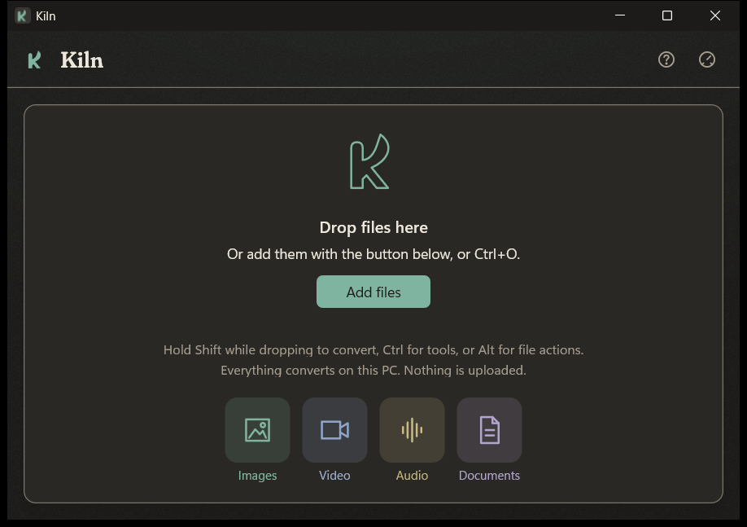
</div>

## The glaze wheel

Three wheels, one per modifier key. Each shows only what fits the files you dropped.

<table>
  <tr>
    <td align="center">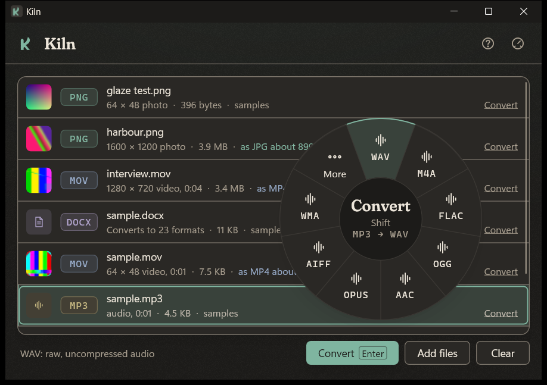<br><b>CONVERT</b><br><sub>Hold <kbd>Shift</kbd>. Every format the files can become</sub></td>
    <td align="center">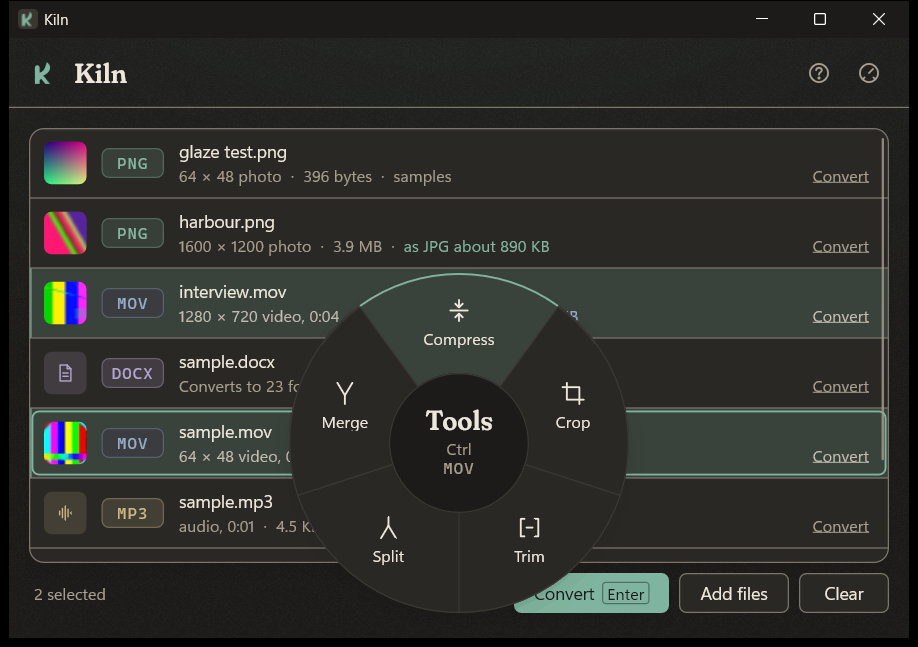<br><b>TOOLS</b><br><sub>Hold <kbd>Ctrl</kbd>. Compress, crop, trim, split, merge</sub></td>
    <td align="center">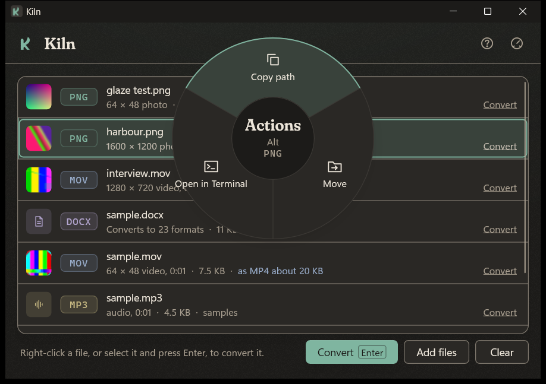<br><b>ACTIONS</b><br><sub>Hold <kbd>Alt</kbd>. Copy path, move, open in Terminal</sub></td>
  </tr>
</table>

From the keyboard, select a row and press <kbd>Enter</kbd> for Convert,
<kbd>Ctrl</kbd>+<kbd>Enter</kbd> for Tools or <kbd>Alt</kbd>+<kbd>Enter</kbd>
for Actions. Inside a wheel, the arrows move, Enter applies and Escape closes.
Tab, or **Options… (Tab)** in the centre, opens the lit format's options.
The footer's **Convert** button, and a row's **Convert** link, open the same
choice.

When the selected files have no format in common, no wheel opens. The footer
says why, as in
`These files have no format in common: MP4 (3), DOCX (2). Select one kind at a time.`,
and the panel offers each kind on its own.

The convert wheel keeps the eight most useful targets close. When a file can
become more than that, a **More** segment pours a second ring around the
first with every other format, grouped by kind.

<div align="center">
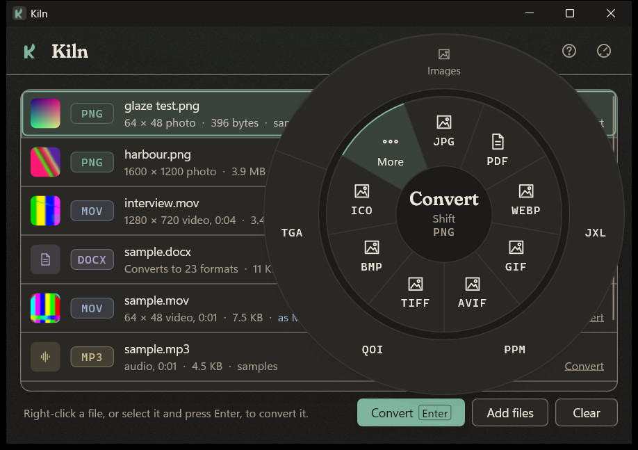
</div>

## Suggestions

When files are added, Kiln looks inside them on this PC and, when one choice
clearly helps, says what it would do and why. A photo saved as PNG suggests
JPG, a MOV suggests MP4, and a large video suggests Compress. When nothing
clearly helps, Kiln says nothing.

- **In the list.** Each row's second line says what Kiln found and, last and in the file's glaze colour, what it suggests, as in `4032 × 3024 photo · 3.1 MB · as JPG about 2 MB`.
- **In the panel.** Under **Turn it into**, the suggested format comes first, with a dot and its estimate. After it come the formats you pick most for that type of file.
- **In the wheel.** A small celadon dot marks the suggested format or tool. Formats keep their places. Opened from the keyboard, the wheel starts on the suggestion, and the footer gives the reason.
- **Your picks.** When you have picked the same format for a type of file at least three times, and it is the one you pick most, Kiln suggests it from then on.
- **What it looks at.** The size and look of a picture, whether it has transparency or motion, the length and bitrate of audio and video, black bars, and whether a PDF has text. Images are read by Kiln itself, except HEIC, AVIF and JXL, which FFmpeg reads like audio and video.

Nothing is uploaded, and picks are counted only in `settings.toml`. Turn
suggestions off with **Suggestions** in **Settings > General**. **Reset
suggestions**, beside it, clears the picks Kiln has counted.

<table>
  <tr>
    <td align="center">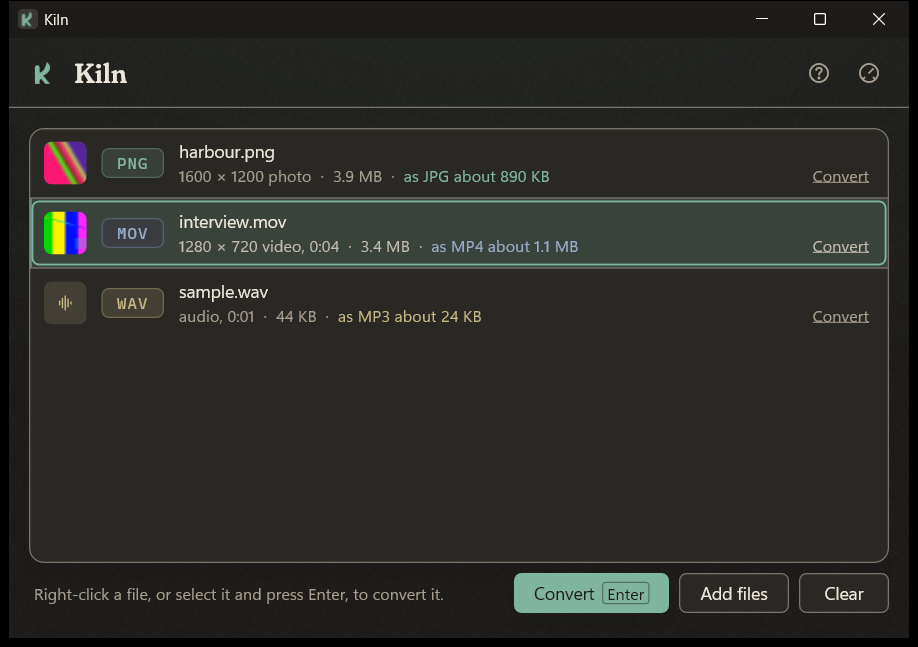<br><b>IN THE LIST</b><br><sub>What Kiln found, and what it suggests</sub></td>
    <td align="center">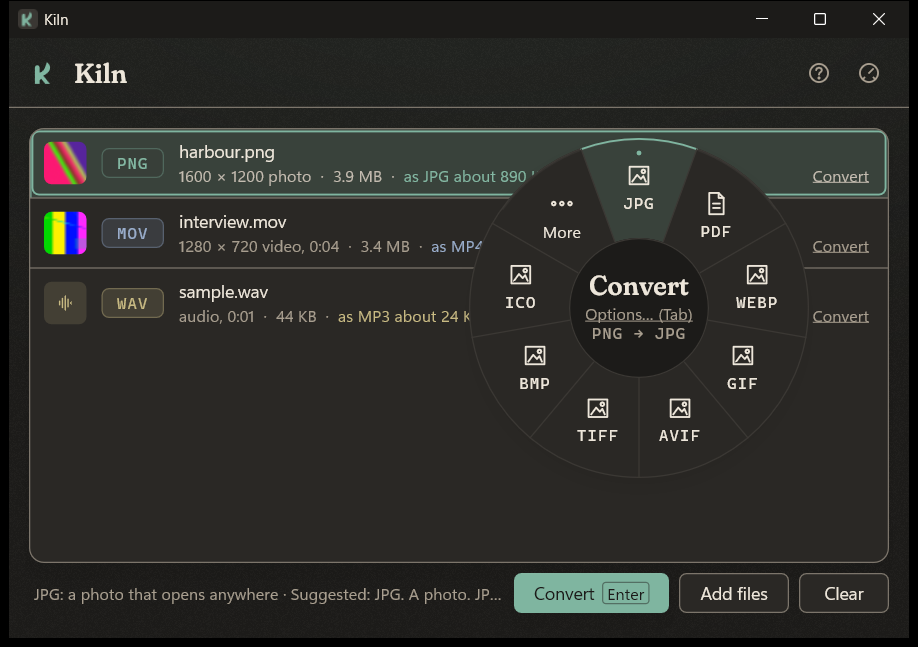<br><b>THE DOT</b><br><sub>On the suggestion, with the reason below</sub></td>
    <td align="center">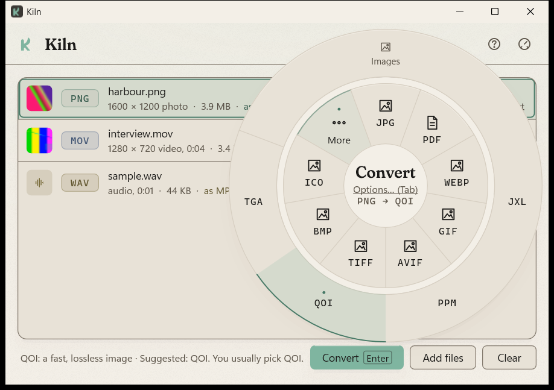<br><b>IN MORE</b><br><sub>On More and on its place in the ring</sub></td>
  </tr>
</table>

## A closer look

<table>
  <tr>
    <td align="center">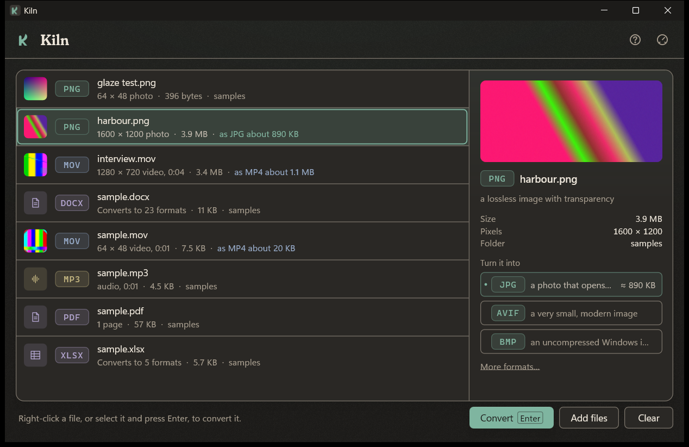<br><b>THE PANEL</b><br><sub>What the selected file is, and what it can become</sub></td>
    <td align="center">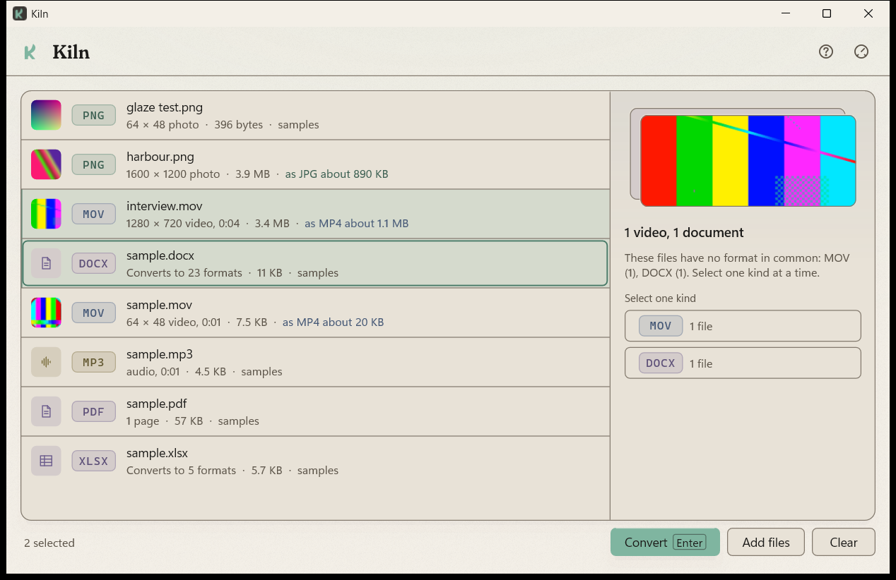<br><b>MIXED FILES</b><br><sub>No format in common, so the panel says why and offers each kind</sub></td>
  </tr>
  <tr>
    <td align="center">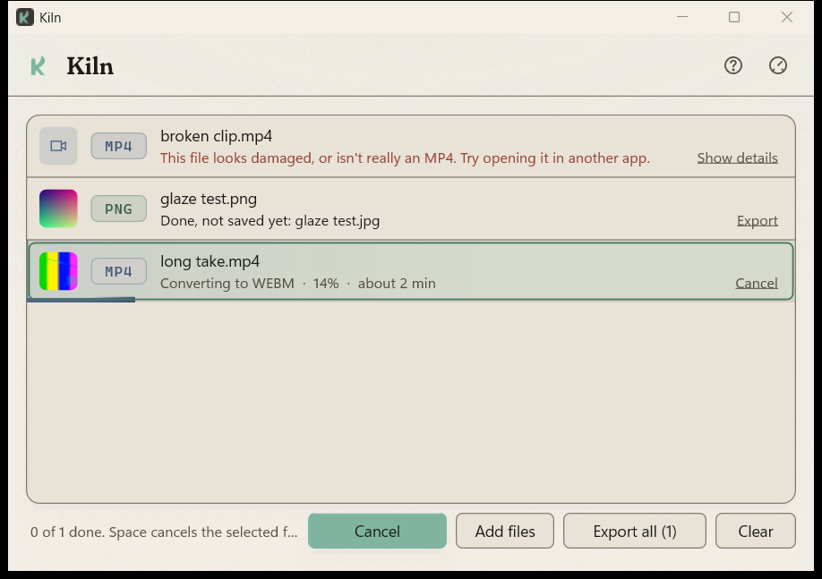<br><b>JOBS</b><br><sub>Run in the background, each with how far it has got, the time left and Cancel</sub></td>
    <td align="center">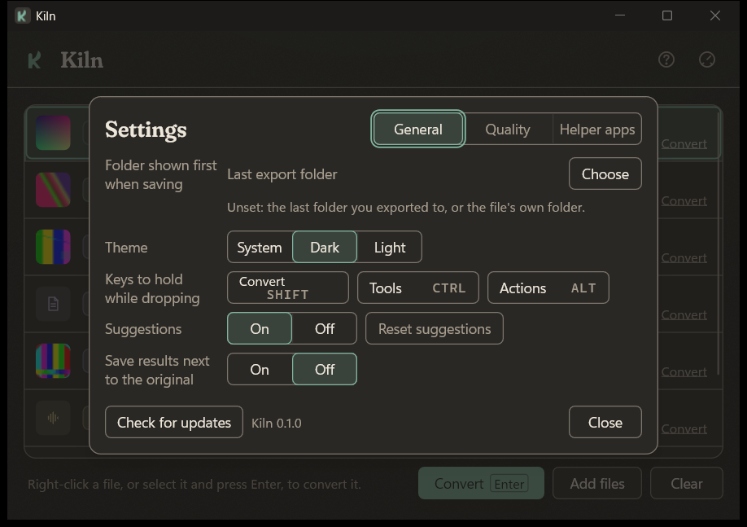<br><b>SETTINGS</b><br><sub>The folder shown first when saving, theme, keys to hold while dropping, suggestions, saving next to the original, quality defaults and helper apps</sub></td>
  </tr>
  <tr>
    <td align="center">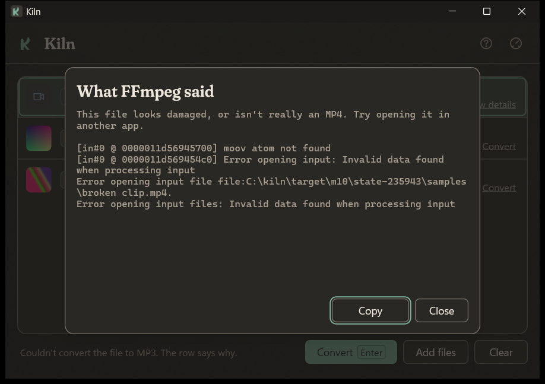<br><b>DETAILS</b><br><sub>A failed job shows one plain line, with the helper app's full output a click away</sub></td>
    <td align="center">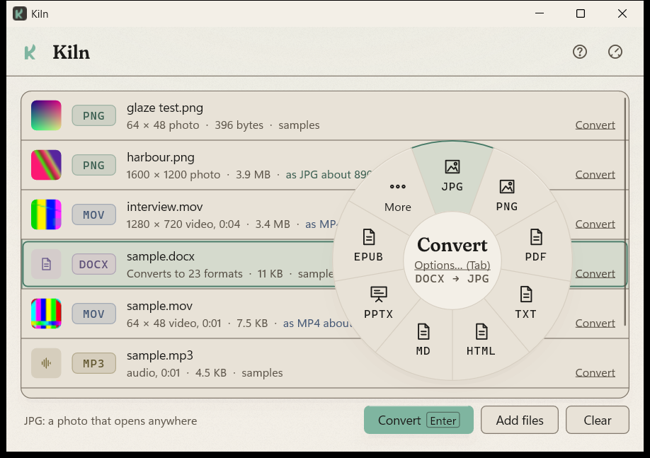<br><b>LIGHT MODE</b><br><sub>Same stoneware, lighter glaze</sub></td>
  </tr>
</table>

## Formats

Kiln knows 85 formats and converts between 1,245 pairs. When no single helper
app does a pair, Kiln chains two steps through a shared format, such as HEIC to
JPG through PNG, or MOBI to PDF through DOCX. The steps run in one temporary
folder, and only the finished file is kept: held inside Kiln until you export
it, or saved next to the original when **Save results next to the original**
is on. You can also drag a finished file out of Kiln to save it where you drop
it.

| Kind | Reads | Converts to | Helper app |
|---|---|---|---|
| Image | PNG, JPG, WEBP, BMP, GIF, TIFF, ICO, TGA, QOI, PPM | any other of those, plus AVIF, JXL and PDF | built in |
| | SVG, and camera RAW: DNG, CR2, CR3, NEF, ARW, ORF, RW2, RAF, PEF, SRW | the image formats above, and PDF | built in (resvg draws SVG, Windows decodes RAW) |
| | AVIF, JXL, HEIC | any image format above, and PDF | FFmpeg |
| Animation | GIF, APNG | any video format | FFmpeg |
| Audio | WAV, MP3, FLAC, OGG, OPUS, M4A, AAC, AIFF, WMA, AC3, WV | any other audio format | FFmpeg |
| Video | MP4, M4V, MOV, MKV, WEBM, AVI, WMV, FLV, MPG, TS, 3GP, OGV | any other video format, any audio format, or an animated GIF, WEBP or APNG | FFmpeg |
| Subtitles | SRT, VTT, ASS | any other of those. MKV and MP4 give up their first subtitle track | FFmpeg |
| Document | MD, HTML, DOCX, ODT, EPUB, RST, TEX, ORG, ADOC, TYP, WIKI, TEXTILE, DBK, FB2, IPYNB | any other of those, plus RTF, TXT and PPTX | Pandoc |
| | the same | PDF and DOC | Pandoc, then LibreOffice |
| E-book | EPUB, MOBI, AZW3 | any other of those. MOBI and AZW3 also become documents and PDF | Calibre |
| PDF | PDF | TXT, and PNG, JPG, WEBP, BMP or TIFF with one image per page | built in (Windows draws the pages) |
| | | DOCX, ODT, DOC, RTF, the Pandoc formats, MOBI and AZW3, from its text | built in, then the document helper apps |
| Office document | DOC, RTF, TXT, and read only PAGES and WPD | DOC, DOCX, ODT, RTF, PDF, and through DOCX the Pandoc formats | LibreOffice |
| | DOCX, ODT | DOC, PDF, and PNG or JPG with one image per page | LibreOffice |
| | read only VSDX and PUB | PDF, and PNG or JPG with one image per page | LibreOffice |
| Spreadsheet | XLSX, XLS, ODS, CSV, and read only NUMBERS | XLSX, XLS, ODS, CSV, PDF and HTML | LibreOffice |
| Presentation | PPTX, PPT, ODP, and read only KEY | PPTX, PPT, ODP, PDF, and PNG or JPG with one image per slide | LibreOffice |

Aliases are accepted on input: JPEG, JFIF, TIF, PNM, PGM, PBM, PAM, NRW, SRF,
SR2, HEIF, HIF, OGA, AIF, MPEG, VOB, MTS, M2TS, SSA, MARKDOWN, HTM, TEXT,
ASCIIDOC, MEDIAWIKI, DOCBOOK, AZW and VSD. The full list lives in
[`crates/kiln-core/formats.toml`](crates/kiln-core/formats.toml), and
`kiln formats FILE` prints what a given file can become.

| Tool | Works on | What it does |
|---|---|---|
| Compress | PNG and JPG images, MP4, MOV, MKV and WebM video, MP3, OGG, Opus, M4A and FLAC audio, PDF | Re-encodes smaller, and keeps the original if the result isn't smaller |
| Crop | images, video | Removes plain borders from images and black bars from video |
| Trim | audio, video | Cuts silence from the start and end of audio, and stretches that are both black and silent from video |
| Split | audio, video, PDF | Cuts audio and video into two halves, and a PDF into one file per page |
| Merge | two or more audio, video, document or PDF files of one type, or images | Joins them in order. Images become one PDF, a page each |

## Quality

Every conversion starts from defaults that suit its kind, and each one can be
changed. Kiln offers only the settings that change the result for that file:

| Converting | Settings offered |
|---|---|
| video to video | quality, resolution, frame rate, audio bitrate |
| an animated GIF or APNG to video | quality, size, frame rate |
| video to an animated GIF or WEBP | quality, size, frame rate |
| video to an animated APNG | size, frame rate |
| video or audio to MP3, OGG, OPUS, M4A, AAC, WMA or AC3 | audio bitrate |
| an image to JPG, AVIF or JXL | quality, size |
| an image to a lossless format | size |
| PDF, document or slide pages to images | page DPI, plus quality for JPG |
| documents, e-books, PDF text, lossless audio | nothing: there's no choice that helps |

**Small** makes noticeably smaller files, fine for sharing. **High**, the
default, is visually lossless for most material. **Best** stays as close to the
source as the format allows. Sizes and frame rates are caps: Kiln never scales
up, so a 720p clip stays 720p when the cap is 1080p.

- **For one conversion.** In the convert wheel, point at a format and press
  <kbd>Tab</kbd> or right-click. The options sheet reads the file first, shows
  what it is (`1280 × 720 · 25 fps · 1:30`), and estimates the result as you
  change things.
- **As defaults.** **Settings > Quality** holds one set for video, images,
  sound quality and page sharpness (DPI). A plain click in the wheel, or on a
  format in the panel, uses them.
- **From the command line.** `--preset`, `--size`, `--fps`, `--audio-kbps`,
  `--dpi` and `--quality` (JPG, 1 to 100).

<table>
  <tr>
    <td align="center">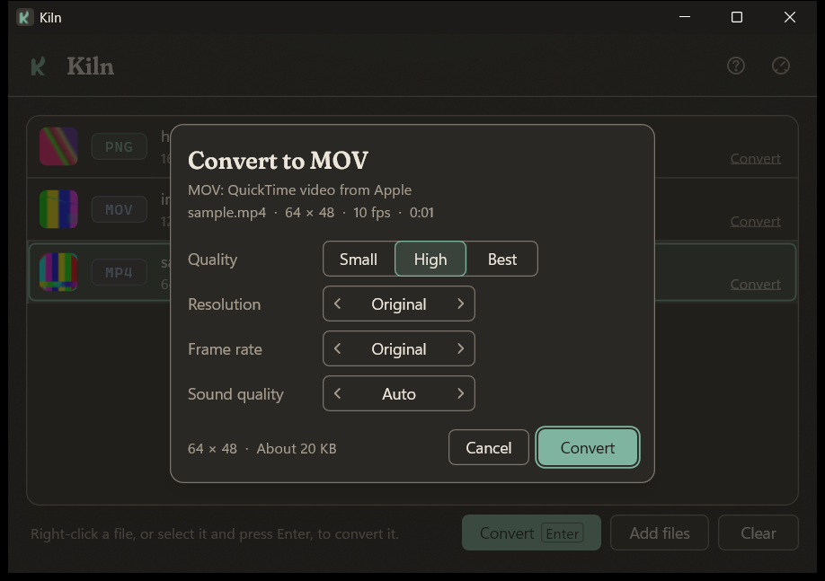<br><b>OPTIONS SHEET</b><br><sub>Only the settings that fit, and an estimate</sub></td>
    <td align="center">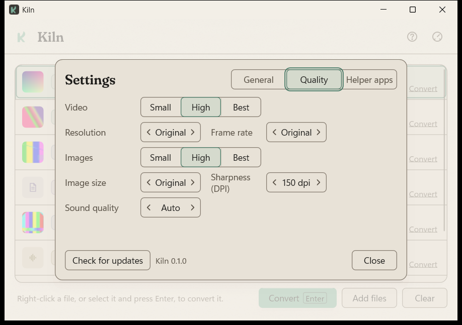<br><b>QUALITY DEFAULTS</b><br><sub>One set for each kind of result</sub></td>
  </tr>
</table>

## Install

- **Installer.** `Kiln-<version>-x64.msi` installs into Program Files, adds a Start menu entry and puts `kiln` on PATH. It also adds Kiln to Open with for the files it converts, and, for the account that installs it, to Send to.
- **Portable.** Unzip `Kiln-<version>-x64-portable.zip` anywhere and run `kiln-app.exe`.

Images convert out of the box. The other kinds use free helper apps that Kiln
finds on your PC. It never bundles or downloads them. A file that needs a
missing one says so on its row, with a link such as **Get FFmpeg** to the app's
own download page.

| Helper app | Needed for |
|---|---|
| [FFmpeg](https://ffmpeg.org/download.html) | audio and video |
| [Pandoc](https://pandoc.org/installing.html) | documents |
| [LibreOffice](https://www.libreoffice.org/download/) (optional) | office files, spreadsheets, slides and PDF output |
| [Calibre](https://calibre-ebook.com/download) (optional) | MOBI and AZW3 e-books |

PDF text, PDF pages as images, SVG and camera RAW need no helper app. Kiln reads
them itself, with Windows drawing PDF pages and decoding RAW.

Kiln looks on PATH, and for LibreOffice and Calibre in their default install
folders. You can
also choose the executables in **Settings > Helper apps**. Each LibreOffice job
runs with a fresh profile inside its temporary folder, with macros and active
content (OLE objects, DDE and other self-updating links) turned off and no
update check.

The only network call Kiln ever makes is **Check for updates** in Settings,
which asks GitHub for the latest release when you press it, and never on its own.

## Settings

Open Settings with the dial in the header or <kbd>Ctrl</kbd>+<kbd>,</kbd>.
Every change is saved straight away to `%APPDATA%\Kiln\settings.toml`, which
you can also edit by hand:

```toml
output_folder = 'D:\Converted'   # the folder shown first when saving; leave
                                 # out for the last folder you exported to,
                                 # or the file's own
theme = "system"                 # system, dark or light
suggestions = true               # false turns suggestions off
save_next_to_original = false    # true saves each result beside its file
save_asked = true                # Kiln has asked about that; false asks again

[keys]                           # shift, ctrl or alt; one per wheel
convert = "shift"
tools = "ctrl"
actions = "alt"

[quality]                        # the defaults in Settings > Quality
video = "high"                   # small, high or best
resolution = "original"          # original, or a cap in lines: 1080
fps = "original"                 # original, or a cap: 30
images = "high"                  # small, high or best
image_size = "original"          # original, or a cap on the long side: 2048
audio_kbps = 192                 # leave out to follow the preset
page_dpi = 150                   # 36 to 600

[engines]                        # leave out to use the ones on PATH
ffmpeg = 'C:\Tools\ffmpeg\bin\ffmpeg.exe'
pandoc = 'C:\Program Files\Pandoc\pandoc.exe'
libreoffice = 'D:\LibreOffice\program\soffice.exe'
calibre = 'C:\Program Files\Calibre2\ebook-convert.exe'

[habits]                         # picks per source type, counted by Kiln
png = { jpg = 4, webp = 1 }
heic = { png = 3 }
```

**Reset suggestions** in **Settings > General** clears `[habits]`.

A file Kiln can't read is left alone. The app starts with the defaults and
says why in the footer.

## Command line

```text
kiln convert INPUT FORMAT [-o DIR] [-p small|high|best] [-q JPG_QUALITY] [--size N] [--fps N]
             [--audio-kbps N] [--dpi N] [--ffmpeg PATH] [--pandoc PATH] [--libreoffice PATH] [--calibre PATH]
kiln tool TOOL INPUTS... [-o DIR]
kiln formats FILE
kiln suggest FILE...
```

`kiln convert` and `kiln tool` write next to the input, or into `-o DIR`,
as soon as they finish. Only the app holds results until you export them,
unless **Save results next to the original** is on.

`kiln` exits with 0 on success, 2 when the request can't be done (an unknown
format, or an unsupported pair or tool), and 1 when a conversion fails.

`kiln suggest` prints each file's suggestion and its reason. It adds an
`(all)` line for a tool when one applies, even to a single file, and, for
several files, one for a conversion they share, when there is one. It
ignores your picks, so its output is the same every time. It exits with 2
when a file doesn't exist.

```text
> kiln suggest photo.png sample.mov
photo.png    JPG  A photo. JPG keeps the look at about 4.2 KB.
sample.mov   MP4  Plays on any phone, PC or browser.
```

## Build from source

You need Rust (stable, 1.82 or newer) with the MSVC toolchain on Windows 10 or 11.

```powershell
cargo build --release          # target\release\kiln-app.exe and kiln.exe
cargo test --workspace         # backend tests need ffmpeg, ffprobe, pandoc, LibreOffice and Calibre
.\packaging\package.ps1        # dist\ MSI and portable ZIP (needs WiX 5 for the MSI)
```

`kiln-core` and `kiln-cli` also build and test on Linux and macOS, which is
handy for working on converters. `kiln-app` is Windows only. Its layout, theme,
icon, inspector, motion and settings logic are plain Rust and are tested on
every platform.

Signing is optional. Set `KILN_SIGN_CERT` (a .pfx path) and
`KILN_SIGN_PASSWORD` before running `package.ps1`, and the executables and
MSI are signed with signtool. Without them, packages are built unsigned.

```text
crates/kiln-core   conversion logic, format registry, job runner (no UI)
crates/kiln-cli    the `kiln` command
crates/kiln-app    the Windows app: Win32, Direct2D, DirectWrite
packaging          MSI definition and the packaging script
docs/screenshots   previews from each milestone
```

<details>
<summary><b>Add a format</b></summary>

<br>

1. Describe the type in [`crates/kiln-core/formats.toml`](crates/kiln-core/formats.toml):

   ```toml
   [formats.aiff]
   kind = "audio"
   aliases = ["aif"]
   ffmpeg = ["-c:a", "pcm_s16be"]
   ```

2. Add it to a route's `from` or `to` list, or to a new `[[route]]`. A pair
   declared twice is an error when the registry loads, so the tests catch it.
3. Add a small sample to `tests/fixtures`. The generator is
   `cargo run -p kiln-core --example gen_fixtures`.
4. Run `cargo test --workspace`. `crates/kiln-cli/tests/pairs.rs` converts
   every supported pair, so the new type is tested both ways.
5. Give it a plain name in `describe_format`, in
   [`crates/kiln-core/src/names.rs`](crates/kiln-core/src/names.rs), such as
   "a small image for the web". A test fails until every extension has one.
6. Add it to the Formats table above. A test checks that this README names
   every format in the registry.

A format that needs a new engine gets a new backend: implement the
`Converter` trait in `kiln-core` and register it in `job.rs`. External
programs are always run with separate arguments, never through a shell.

</details>

<details>
<summary><b>Known limitations</b></summary>

<br>

- A still WEBP is written lossless, so a WEBP made from a JPG can be larger than the JPG. Animated WEBP from video is lossy.
- An animated GIF or APNG converted to another image format keeps only its first frame. Convert it to video to keep the motion.
- HEIC, SVG, camera RAW, Pages, Numbers, Keynote, WordPerfect, Visio and Publisher files are read only.
- PDF to a document keeps the text and its paragraphs, not the layout. A scanned PDF has no text to take out.
- MOBI and AZW3 need Calibre, and only files without DRM convert.
- Camera RAW is decoded by Windows, so a RAW type needs the Raw Image Extension from the Microsoft Store on older Windows builds.
- Compress works on PNG and JPG images, MP4, MOV, MKV and WebM video, MP3, OGG, Opus, M4A and FLAC audio, and PDF. Other types have no tighter encoding to re-save with.
- Trim on video cuts only stretches that are both black and silent, and the kept part is re-encoded.
- Office files and documents other than PDF have no tools other than Merge for documents.
- Previews come from Windows' own thumbnails, so a PDF or Office file shows a picture only where a thumbnail handler is installed. Without one, it shows its kind's tile.
- The update check returns "No releases are published yet" until a release exists on GitHub.

</details>

<details>
<summary><b>Performance</b></summary>

<br>

On the development PC (release build, Windows 11, NVIDIA GPU), the window
is visible 46 to 97 ms after launch, with no white first frame. With 500 files
listed and their previews loading, the UI thread answers in 1.74 ms (95th
percentile), and the working set is 75.8 MB. With four conversions running, a
key reaches the screen in 20.6 ms (median). `kiln-app.exe` is about 8.6 MB
and `kiln.exe` about 7.4 MB. Most of the app's size is the in-process PDF, SVG
and image code that needs no engine.

</details>

## Contributing

Bug reports and format requests are welcome in
[Issues](https://github.com/chancrisp/kiln/issues). Before changing code, read
[CONTRIBUTING.md](CONTRIBUTING.md). [DESIGN.md](DESIGN.md) explains how Kiln
looks and sounds, and why. [VISUAL_TESTING.md](VISUAL_TESTING.md) is the
checklist to run before a release.

<div align="center">

<br>

**[Download Kiln](https://github.com/chancrisp/kiln/releases)**

<sub>Built with Rust, Win32, Direct2D and DirectWrite. Made by Chandler Crisp.<br>
Apache License 2.0. See <a href="LICENSE">LICENSE</a> and <a href="THIRD_PARTY_LICENSES">THIRD_PARTY_LICENSES</a>.</sub>

</div>
