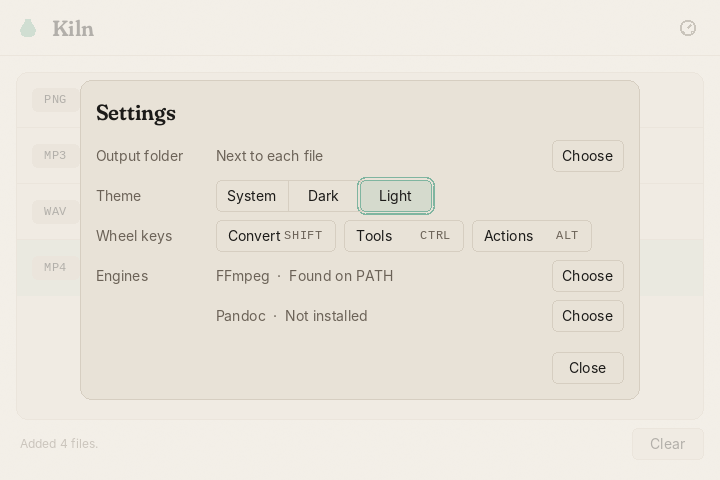
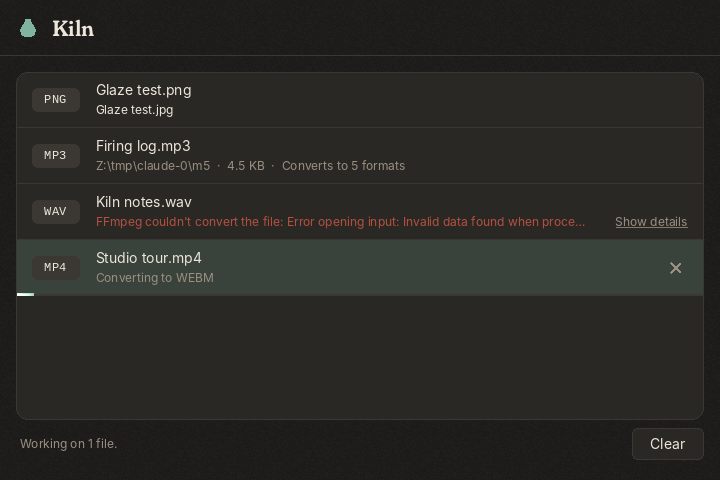

# Kiln

Kiln is a native Windows file converter. Drop a file on the window, hold a
key, and pick what it should become from a radial menu called the glaze
wheel. Everything happens on your PC. Nothing is uploaded.


| | |
|---|---|
|  |  |

## Features

- **Three wheels.** While dragging files over the window, hold a modifier:
  - **Shift** for the convert wheel, which offers only the formats every dropped file can become.
  - **Ctrl** for file tools: compress, crop, trim, split and merge.
  - **Alt** for file actions: copy path, move, and open in Windows Terminal.

  Each key can be reassigned in Settings.
- **Works from the keyboard.** Select a row with the arrow keys.
  - Enter opens the convert wheel, Ctrl+Enter opens tools, and Alt+Enter opens actions.
  - Inside a wheel, the arrows move, Enter applies and Escape closes.
- **Jobs run in the background** on a small worker pool. Each row shows its progress as a thin line and can be cancelled.
- **Nothing is overwritten.**
  - Results go next to the input, or to a folder you choose. A taken name becomes `name (1).jpg`.
  - Names Windows reserves, such as `CON`, are made safe.
  - Temporary files live in a per-job folder under `%TEMP%\Kiln` and are removed when the job finishes or is cancelled.
- **Offline.** Kiln makes no network calls.
- **Small and quick.** The app is a single native executable of under 2 MB. It draws with Direct2D and DirectWrite, with no web view.
- **Light and dark.** The theme follows the Windows app mode, or you can choose one. Kiln is per-monitor DPI aware.
- **A command line too.** `kiln convert photo.png jpg` does the same work from a terminal.

## Formats

| Kind | Reads | Converts to | Engine |
|---|---|---|---|
| Image | PNG | JPG | built in |
| Audio | WAV, MP3, FLAC, OGG, OPUS, M4A | any other audio format | FFmpeg |
| Video | MP4, MOV, MKV, WEBM | any other video format, or audio (WAV, MP3, FLAC, OGG, OPUS, M4A) | FFmpeg |
| Document | MD, HTML, DOCX, ODT, EPUB, RST, TEX | any other of those, plus RTF and TXT | Pandoc |

Aliases are accepted on input: JPEG, OGA, M4V, MARKDOWN and HTM. The full
list lives in [`crates/kiln-core/formats.toml`](crates/kiln-core/formats.toml),
and `kiln formats FILE` prints what a given file can become.

| Tool | Works on | What it does |
|---|---|---|
| Compress | images, video, audio (not WAV) | Re-encodes smaller, and keeps the original if the result isn't smaller |
| Crop | images, video | Removes plain borders from images and black bars from video |
| Trim | audio | Cuts silence from the start and end |
| Split | audio, video | Cuts the file into two halves |
| Merge | two or more audio, video or document files of one type | Joins them in order |

## Install

- **Installer.** `Kiln-<version>-x64.msi` installs into Program Files and adds a Start menu entry. It also puts `kiln` on PATH.
- **Portable.** Unzip `Kiln-<version>-x64-portable.zip` anywhere and run `kiln-app.exe`.

Images convert out of the box. Audio and video need [FFmpeg](https://ffmpeg.org/download.html), and documents need [Pandoc](https://pandoc.org/installing.html). Kiln doesn't bundle or download either one. Install them, and Kiln finds them on PATH. You can also choose the executables in **Settings > Engines**.

## Settings

Open Settings with the dial in the header or Ctrl+,. Every change is saved
straight away to `%APPDATA%\Kiln\settings.toml`, which you can also edit by hand:

```toml
output_folder = 'D:\Converted'   # leave out to write next to each file
theme = "system"                 # system, dark or light

[keys]                           # shift, ctrl or alt; one per wheel
convert = "shift"
tools = "ctrl"
actions = "alt"

[engines]                        # leave out to use the ones on PATH
ffmpeg = 'C:\Tools\ffmpeg\bin\ffmpeg.exe'
pandoc = 'C:\Program Files\Pandoc\pandoc.exe'
```

A file Kiln can't read is left alone. The app starts with the defaults and
says why in the footer.

## Command line

```text
kiln convert INPUT FORMAT [-o DIR] [-q QUALITY] [--ffmpeg PATH] [--pandoc PATH]
kiln tool TOOL INPUTS... [-o DIR]
kiln formats FILE
```

`kiln` exits with 0 on success, 2 when the request can't be done (an unknown
format, or an unsupported pair or tool), and 1 when a conversion fails.

## Build from source

You need Rust (stable, 1.82 or newer) with the MSVC toolchain on Windows 10 or 11.

```powershell
cargo build --release          # target\release\kiln-app.exe and kiln.exe
cargo test --workspace         # backend tests need ffmpeg, ffprobe and pandoc on PATH
.\packaging\package.ps1        # dist\ MSI and portable ZIP (needs WiX 5 for the MSI)
```

`kiln-core` and `kiln-cli` also build and test on Linux and macOS, which is handy for
working on converters. `kiln-app` is Windows only. Its layout, theme, icon
and settings logic are plain Rust and are tested on every platform.

Signing is optional. Set `KILN_SIGN_CERT` (a .pfx path) and
`KILN_SIGN_PASSWORD` before running `package.ps1`, and the executables and
MSI are signed with signtool. Without them, packages are built unsigned.

## Add a format

1. Describe the type in [`crates/kiln-core/formats.toml`](crates/kiln-core/formats.toml):

   ```toml
   [formats.aiff]
   kind = "audio"
   aliases = ["aif"]
   ffmpeg = ["-c:a", "pcm_s16be"]
   ```

2. Add it to a route's `from` or `to` list, or to a new `[[route]]`. A pair
   declared twice is an error when the registry loads, so the tests catch it.
3. Add a small sample to `tests/fixtures`. The generator is
   `cargo run -p kiln-core --example gen_fixtures`.
4. Run `cargo test --workspace`. `crates/kiln-cli/tests/pairs.rs` converts
   every supported pair, so the new type is tested both ways.
5. Add it to the table above. A test checks that this README names every
   format in the registry.

A format that needs a new engine gets a new backend: implement the
`Converter` trait in `kiln-core` and register it in `job.rs`. External
programs are always run with separate arguments, never through a shell.

## Project layout

```text
crates/kiln-core   conversion logic, format registry, job runner (no UI)
crates/kiln-cli    the `kiln` command
crates/kiln-app    the Windows app: Win32, Direct2D, DirectWrite
packaging          MSI definition and the packaging script
docs/screenshots   previews from each milestone
```

[DESIGN.md](DESIGN.md) explains how Kiln looks and sounds, and why.
[VISUAL_TESTING.md](VISUAL_TESTING.md) is the checklist to run before a
release.

## License

Apache License 2.0. See [LICENSE](LICENSE). Bundled and external components
are listed in [THIRD_PARTY_LICENSES](THIRD_PARTY_LICENSES).
